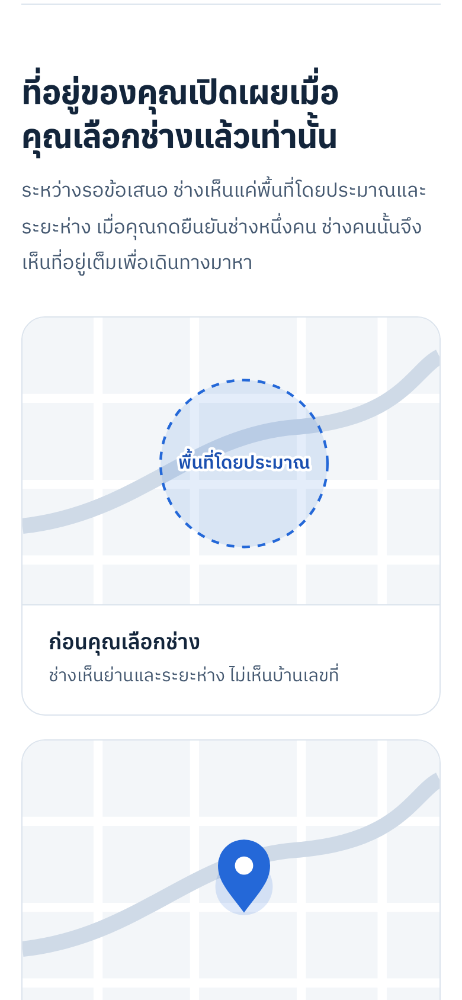
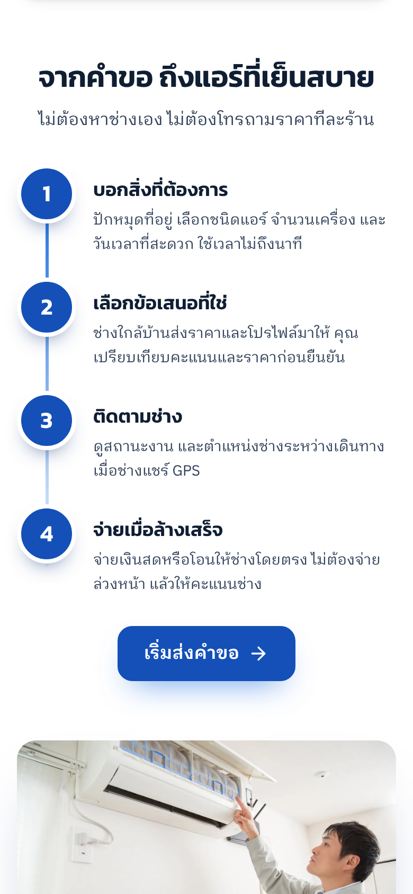
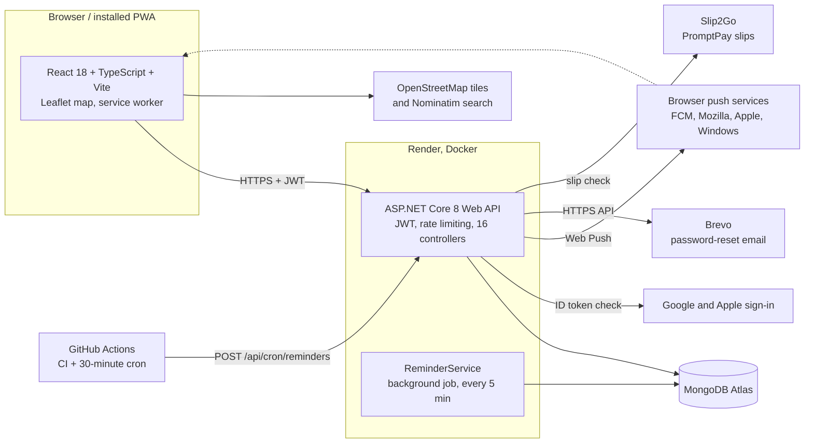
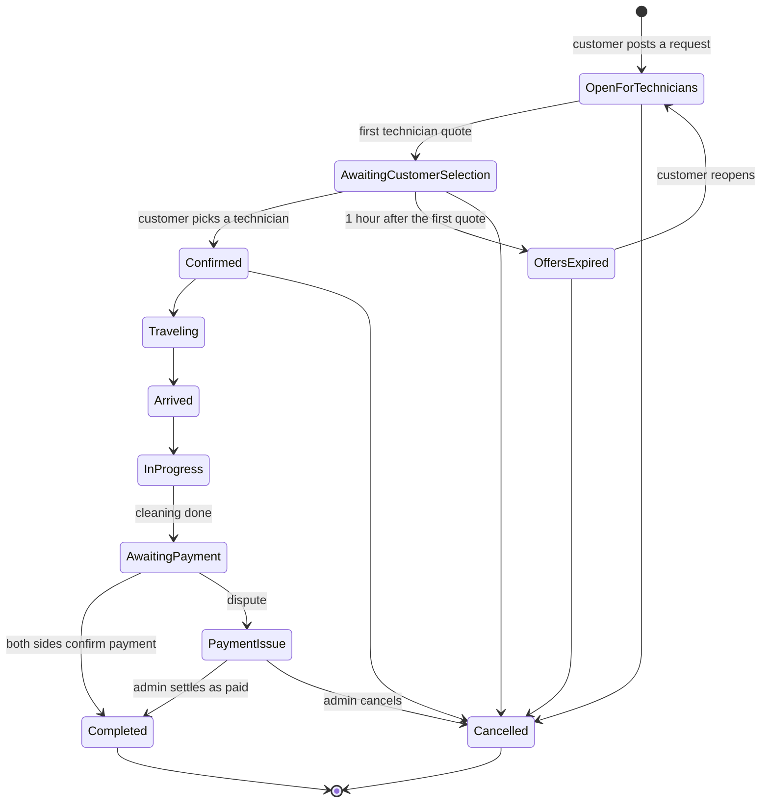

# AirClean

[ภาษาไทย](README.md) · **English**

**A marketplace that connects people who need their air conditioner cleaned with technicians nearby.**
The customer posts one request. Technicians in the area send quotes. The customer compares them and picks one, and only then does that technician see the address.

[](https://github.com/namethzz/Air-clean-/actions/workflows/build.yml)

Built for the Thai market, so the interface is in Thai. Full stack: React + TypeScript, ASP.NET Core 8, MongoDB.

<table>
  <tr>
    <td></td>
    <td></td>
    <td></td>
    <td></td>
  </tr>
  <tr>
    <td align="center">Landing</td>
    <td align="center">Address privacy</td>
    <td align="center">How it works</td>
    <td align="center">Sign-up by role</td>
  </tr>
</table>

These are the public pages, captured at phone width (390 px). The signed-in screens need the API and a database; see [Run it locally](#run-it-locally) to open them with demo data.

## What it does

- **Four roles.** Customers, technicians, building managers (whole buildings, room by room) and administrators each get their own workspace.
- **Quotes instead of a fixed price.** Nearby technicians see open jobs sorted by distance and send a quote. The customer has one hour from the first quote to choose; after that the offers lapse and the request can be reopened with one tap.
- **A live job.** After confirmation the customer follows the technician on a map. The technician counts finished rooms, attaches before and after photos, and closes the job in one step.
- **Cash on delivery.** The customer pays the technician directly. AirClean never holds money; both sides confirm, and a dispute goes to an admin queue.
- **Aircon Passport.** Each finished job is written to the unit's service history, and the next cleaning is scheduled for six months later.
- **Technician onboarding.** Applications need an ID card and are approved by an admin. After approval a technician gets a free trial and then pays a monthly membership by PromptPay; the transfer slip is checked automatically through Slip2Go.
- **Notifications.** An in-app bell plus Web Push, including iPhone when the app is added to the Home Screen.
- **Sign-in.** Email and password, Google, and Apple. Password reset links are single-use and sign out the account's other devices.

The full feature list and every configuration setting are in [docs/REFERENCE.md](docs/REFERENCE.md). A walkthrough of the product in Thai is in [docs/PROJECT-SUMMARY.md](docs/PROJECT-SUMMARY.md).

## Architecture



### A job's life



A technician can also close a job in a single step from any active state (`POST /api/bookings/{id}/complete`), which records the payment, the service report and the passport history together.

## Problems worth a closer look

### 1. Showing jobs to technicians without revealing where the customer lives

A nearby-jobs feed has to show distance, but distance from an exact pin lets a technician work out the address by searching from a few places. Two things prevent that. `BlurredDistanceKm` measures to a point 300–600 m away from the pin, and that offset comes from the job's ID rather than a random number, so repeating the search cannot average the noise away. `OpenJobView` then strips the customer's name, address, coordinates, notes, room list and every other technician's quote from what the feed returns. The full details appear only after the customer confirms that technician.
See `ApiHelpers.cs` and `BookingOffersController.cs`. The smoke test checks that the destination stays hidden before selection and that competing quotes are never visible.

### 2. Two people, one job: concurrency without transactions

The app has no multi-document transactions. It relies on single-document atomic updates and unique indexes, so each race has one specific answer:

- **Job state.** Status changes, quotes, technician confirmation and payment confirmation write only if `UpdatedAt` still holds the value that was read. The slower of two simultaneous requests matches nothing and gets a `409` asking it to reload, instead of overwriting the other change.
- **Reset links.** The update filter includes the token hash, so a link works once even when two requests arrive together.
- **Receipts.** The filter requires `ReceiptNo == null`, so a double tap issues one number.
- **Saved addresses.** A unique index on user and name, plus handling of the duplicate-key error, turns two simultaneous saves into one entry.
- **Payments.** Partial unique indexes allow one approved payment per bank transaction and one waiting slip per technician.

The smoke test runs overlapping quotes and simultaneous address saves and checks that nothing is lost.

### 3. Web Push with no push library

Push is implemented directly from the standards: RFC 8030 for delivery, RFC 8291 for `aes128gcm` payload encryption, and RFC 8292 for VAPID, using only .NET's built-in cryptography (`WebPushSender.cs`). The key pair is generated once and kept in the database, so a new deployment needs no setup. In production the server accepts only known push-service hosts as subscription endpoints, so a user-supplied URL cannot make it call arbitrary addresses. Subscriptions the push service reports as gone are removed.
Checking your own encryption with your own code proves little, so `tests/fake_push.py` acts as a browser and push service: it verifies the VAPID signature and decrypts the payload independently.

### 4. Time-based rules on a server that goes to sleep

Offers must lapse an hour after the first quote and reminders must go out on time, but the free hosting plan puts the server to sleep. The rules therefore do not depend on one scheduler:

- Expiry is applied lazily whenever jobs are read (`OfferTimer.ExpireDueAsync`).
- `ReminderService` runs every 5 minutes while the server is awake.
- A scheduled GitHub Actions workflow calls `POST /api/cron/reminders` every 30 minutes between 07:00 and 21:00 Thai time, which also wakes the server. The endpoint compares the key in constant time and does not exist unless `CRON_KEY` is set.

Every expiry and reminder is claimed with a conditional database update before anything is sent, so overlapping runs send once. Outside production the endpoint accepts a pretend clock (`?at=`), which is how the smoke test covers reminder timing.

## Tech stack

| Layer | Technology |
|---|---|
| Frontend | React 18, TypeScript, Vite, Leaflet and OpenStreetMap, an installable PWA with a service worker |
| Backend | ASP.NET Core 8 Web API, JWT bearer authentication, ASP.NET Identity password hashing, sliding-window rate limits on sign-in and password reset |
| Database | MongoDB (Atlas in production) with the official .NET driver |
| Integrations | Google and Apple sign-in, Brevo email, Web Push (VAPID), Slip2Go slip verification, optional Google Places search |
| Deployment | Render: a Docker web service for the API (defined in `render.yaml`) and a static site for the frontend |
| CI | GitHub Actions: build both apps, run the xUnit and Vitest unit tests, then the smoke test against a throwaway MongoDB |

## Project layout

```
backend/AirClean.Api.Tests   xUnit tests for the rules and the Slip2Go check
backend/AirClean.Api
  Controllers/   One controller per topic, all under /api:
                 Auth, Notifications, Addresses, Technicians, Bookings, BookingOffers,
                 JobCompletion, Issues, Receipts, JobPhotos, Dashboard, AirConditioners,
                 ServiceReports, Reviews, Membership.
                 AirCleanControllerBase holds what they share (the database, the signed-in
                 user, status e-mails); ApiHelpers holds pure rules (quotes, distance, windows).
  Services/      Notifier, WebPushSender, EmailSender, SlipVerifier, ExternalIdentityValidator,
                 OfferTimer, ReminderService, Membership
  Models/ DTOs/ Data/   Entities, request and response contracts, MongoStore and indexes
frontend/src
  pages/         One page per screen and role; routing is a switch on a page key in App.tsx
  components/    Shared UI: booking form, map picker, job stepper, notification bell
  lib/           API client, PromptPay QR payload, Thai baht text, schedule-clash check
tests/           End-to-end smoke test plus stand-ins for Google/Apple, push and Slip2Go
docs/            REFERENCE.md (configuration), PROJECT-SUMMARY.md (Thai), customer-ui.md, screenshots/
```

## Run it locally

You need the .NET 8 SDK, Node 20 and a MongoDB (a container is easiest).

```bash
# 1. Database
docker run -d --name airclean-mongo -p 27017:27017 mongo:7

# 2. API on http://localhost:5080, with demo data
cd backend/AirClean.Api
MONGODB_URI=mongodb://localhost:27017 MONGODB_DATABASE=airclean_demo \
JWT_KEY="any-random-string-of-at-least-32-characters" \
SEED_DEMO_DATA=true dotnet run

# 3. Frontend on http://localhost:5173 (in another terminal)
cd frontend
cp .env.example .env.local
npm install
npm run dev
```

Demo accounts exist only in a database seeded this way, and the password for all of them is `Aircare123!`:

| Role | Email |
|---|---|
| Customer | `customer@aircare.demo` |
| Technician | `technician@aircare.demo` (also `technician2@…`, `technician3@…`) |
| Building manager | `manager@aircare.demo` |
| Admin | `admin@aircare.demo` |

Seeding runs only when the database has no users, and never when `ASPNETCORE_ENVIRONMENT` is `Production`, so these accounts cannot appear on a live deployment.

## Tests

Three layers run on every pull request:

- **Backend unit tests** (xUnit, `backend/AirClean.Api.Tests`): the Slip2Go check against a fake service, time windows, the blurred distance, membership states, quotes and names. `dotnet test backend/AirClean.Api.Tests`
- **Frontend unit tests** (Vitest, `frontend/src/lib/*.test.ts`): PromptPay QR payloads, schedule clashes, room lists, the offer countdown, Thai amounts in words. `npm test` in `frontend/`
- **End-to-end smoke test**, described below.

`tests/marketplace_smoke.py` drives the real API over HTTP against a disposable database. It covers account ownership, address privacy, approval rules, concurrent writes, password reset and session sign-out, Google and Apple sign-in, push encryption, payment disputes, receipts, rescheduling, membership slips and reminder timing. External services are replaced by local stand-ins in `tests/`.

```bash
# with the API running against a disposable database (see .github/workflows/build.yml for the settings)
python3 tests/marketplace_smoke.py
```

Never point it at a real database.

## Status

Payment is cash on delivery between customer and technician, and the app holds no money. Before a public launch the remaining items are listed in [docs/REFERENCE.md](docs/REFERENCE.md#limitations-before-a-public-launch).
