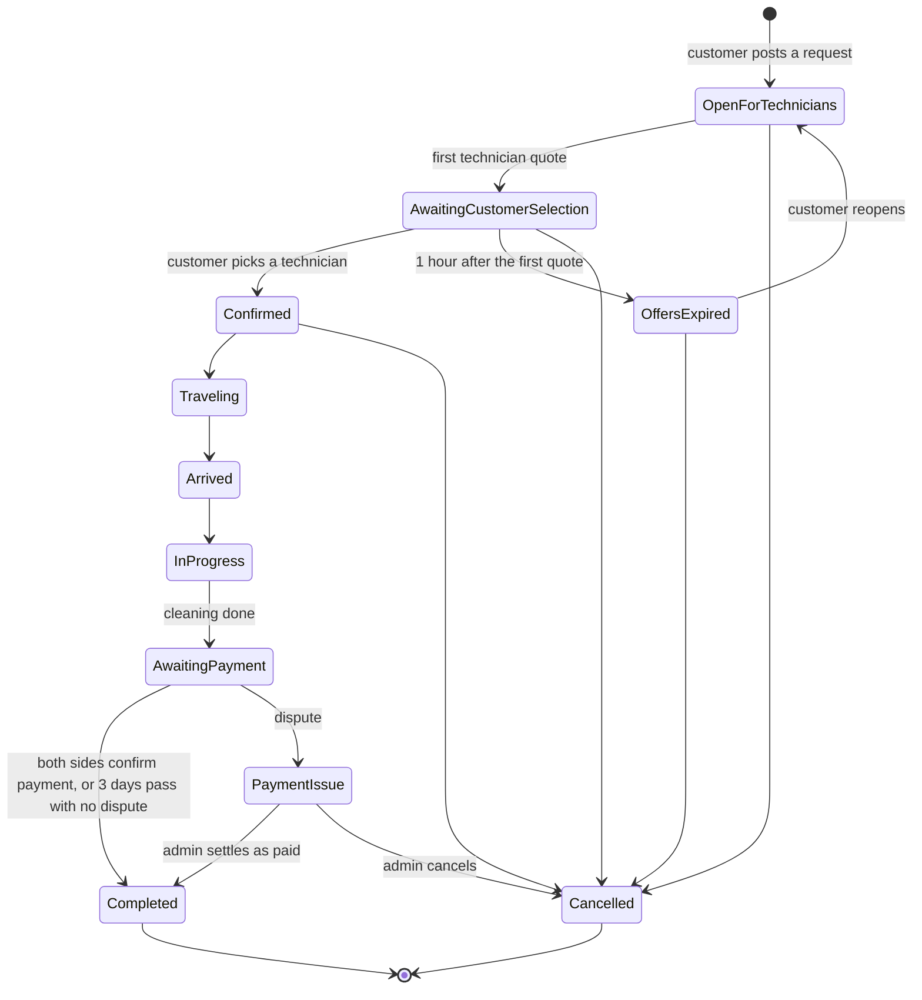

<p align="center"></p>

# AirClean

[ภาษาไทย](README.md) · **English**

**A marketplace that connects people who need their air conditioner cleaned with technicians nearby.**
The customer posts one request. Technicians in the area send quotes. The customer compares them and picks one, and only then does that technician see the address.

[](https://github.com/namethzz/Air-clean-/actions/workflows/build.yml)

Live at **[aircare-connect-web.onrender.com](https://aircare-connect-web.onrender.com)** (free hosting sleeps when idle, so the first visit can take 30–60 seconds).

Built for the Thai market, so the interface is in Thai. Full stack: React + TypeScript, ASP.NET Core 8, MongoDB. Technician memberships are collected for real through PromptPay, with slips checked against the bank automatically.

<table>
  <tr>
    <td></td>
    <td></td>
    <td></td>
    <td></td>
  </tr>
  <tr>
    <td align="center">Landing</td>
    <td align="center">Address privacy</td>
    <td align="center">How it works</td>
    <td align="center">Sign-up by role</td>
  </tr>
  <tr>
    <td></td>
    <td></td>
    <td></td>
    <td></td>
  </tr>
  <tr>
    <td align="center">Choosing a quote</td>
    <td align="center">Request form</td>
    <td align="center">Nearby jobs</td>
    <td align="center">Technician's schedule</td>
  </tr>
  <tr>
    <td></td>
    <td></td>
    <td></td>
    <td></td>
  </tr>
  <tr>
    <td align="center">Technician setup: work</td>
    <td align="center">Technician setup: prices</td>
    <td align="center">Confirmed job</td>
    <td align="center">Rooms in a building</td>
  </tr>
</table>

Captured at phone width (390 px) with demo data. The signed-in screens need the API and a database; see [Run it locally](#run-it-locally) to open them with demo data. The design system is described in [DESIGN.md](DESIGN.md).

## What it does

- **Four roles.** Customers, technicians, building managers (whole buildings, room by room) and administrators each get their own workspace.
- **Prices people can follow.** The customer only describes what they can see (kind of unit, how many, symptoms). Each technician quotes from their own price list, the going rate across technicians is shown beside it, and the price is locked once a technician is chosen. A change on site is asked for in the app with a reason, and the customer approves it first.
- **Quotes instead of a fixed price.** Nearby technicians see open jobs sorted by distance and send a quote. The customer has one hour from the first quote to choose; after that the offers lapse and the request can be reopened with one tap.
- **A live job.** After confirmation the customer follows the technician on a map. The technician counts finished rooms, attaches before and after photos, and closes the job in one step.
- **Cash on delivery.** The customer pays the technician directly. AirClean never holds money; both sides confirm (if the customer neither confirms nor disputes within 3 days, the job closes by itself), and a dispute goes to an admin queue. Receipts spell out the amount in Thai words and can be made out to a company with its tax ID.
- **Aircon Passport.** Each finished job is written to the unit's service history, and the next cleaning is scheduled for six months later.
- **Technician onboarding.** After sign-up a technician sets up their work step by step: the kinds of unit they clean, deep cleans or not, other work, a price per unit (beside what most technicians charge), area and hours, and an ID card, then sends it for an admin to review. They only see jobs they do. After approval they get a free trial, then pay a monthly membership by PromptPay; the transfer slip is checked automatically through Slip2Go.
- **Notifications.** An in-app bell plus Web Push, including iPhone when the app is added to the Home Screen.
- **Sign-in.** Email and password, or Google (the Google picture becomes the profile photo). Password reset links are single-use and sign out the account's other devices.
- **Delete the account.** On the account tab, confirmed with the password (or by typing “ลบบัญชี” for Google-only accounts). Jobs not started are cancelled and the other side is told; a job under way must close first. Personal data is removed; past jobs and receipts stay without the name or phone.

The full feature list and every configuration setting are in [docs/REFERENCE.md](docs/REFERENCE.md). A walkthrough of the product in Thai is in [docs/PROJECT-SUMMARY.md](docs/PROJECT-SUMMARY.md).

## Architecture


### A job's life



A technician can also close a job in a single step from any active state (`POST /api/bookings/{id}/complete`). That records the service report and how the customer paid, then waits for the customer to confirm. If the customer neither confirms nor disputes within 3 days, `JobClosing.AutoCloseAsync` closes the job as paid, so a technician is not left waiting on a customer who forgot to tap. The passport history and the technician's completed-job count update when the job reaches Completed. A pending on-site price change blocks closing until the customer answers it.

## Problems worth a closer look

### 1. Showing jobs to technicians without revealing where the customer lives

A nearby-jobs feed has to show distance, but distance from an exact pin lets a technician work out the address by searching from a few places. Two things prevent that. `BlurredDistanceKm` measures to a point 300–700 m from the pin in any direction and rounds up to whole kilometres. `FuzzPoint` draws that point once from a cryptographic random source when the job is created, and the job stores it (`FuzzLatitude`/`FuzzLongitude`). Every search measures from the same point, so repeating the search cannot average the noise away, and nothing about the point can be worked out from the job's ID. `OpenJobView` then strips the customer's name, address, coordinates, notes, room list and every other technician's quote from what the feed returns. The full details appear only after the customer confirms that technician.
See `ApiHelpers.cs` and `BookingOffersController.cs`. The smoke test checks that the destination stays hidden before selection and that competing quotes are never visible.

### 2. Two people, one job: concurrency without transactions

The app has no multi-document transactions. It relies on single-document atomic updates and unique indexes, so each race has one specific answer:

- **Job state.** Status changes, quotes, technician confirmation and payment confirmation write only if `UpdatedAt` still holds the value that was read. The slower of two simultaneous requests matches nothing and gets a `409` asking it to reload, instead of overwriting the other change.
- **Reset links.** The update filter includes the token hash, so a link works once even when two requests arrive together.
- **Receipts.** The filter requires `ReceiptNo == null`, so a double tap issues one number.
- **Saved addresses.** A unique index on user and name, plus handling of the duplicate-key error, turns two simultaneous saves into one entry.
- **Payments.** Partial unique indexes allow one approved payment per bank transaction and one waiting slip per technician.

The smoke test runs overlapping quotes and simultaneous address saves and checks that nothing is lost.

### 3. Web Push with no push library

Push is implemented directly from the standards: RFC 8030 for delivery, RFC 8291 for `aes128gcm` payload encryption, and RFC 8292 for VAPID, using only .NET's built-in cryptography (`WebPushSender.cs`). The key pair is generated once and kept in the database, so a new deployment needs no setup. In production the server accepts only known push-service hosts as subscription endpoints, so a user-supplied URL cannot make it call arbitrary addresses. Subscriptions the push service reports as gone are removed.
Checking your own encryption with your own code proves little, so `tests/fake_push.py` acts as a browser and push service: it verifies the VAPID signature and decrypts the payload independently.

### 4. Time-based rules on a server that goes to sleep

Offers must lapse an hour after the first quote and reminders must go out on time, but the free hosting plan puts the server to sleep. The rules therefore do not depend on one scheduler:

- Expiry is applied lazily whenever jobs are read (`OfferTimer.ExpireDueAsync`).
- `ReminderService` runs every 5 minutes while the server is awake.
- A scheduled GitHub Actions workflow calls `POST /api/cron/reminders` every 30 minutes between 07:00 and 21:30 Thai time, which also wakes the server. The endpoint compares the key in constant time and does not exist unless `CRON_KEY` is set. The repository needs two secrets, `AIRCLEAN_API_URL` and `AIRCLEAN_CRON_KEY` (the same value as `CRON_KEY`); without them the workflow skips quietly.
- The same run closes jobs the technician marked paid 3 days ago, retries slips the bank could not confirm yet, and warns technicians whose membership is about to end.

Every expiry and reminder is claimed with a conditional database update before anything is sent, so overlapping runs send once. Outside production the endpoint accepts a pretend clock (`?at=`), which is how the smoke test covers reminder timing.

### 5. Checking a membership slip actually paid

Technicians pay through a PromptPay QR that the app builds itself to the EMVCo standard (checked against the `promptpay-qr` library), then attach the transfer slip. The server sends the image to Slip2Go with the full set of conditions: a real transfer, to AirClean's PromptPay account, the exact amount to the satang, made within 2 days, and never used before.
The answer falls into three kinds: passed (the membership extends at once), failed (with the reason, such as a reused slip or the wrong account), and undecided (the bank has not confirmed yet, or the service is down). Undecided slips are retried in the background every few minutes, and the admin hears about them only when needed. The image hash and the bank's transaction reference are stored too, so the same slip cannot pay twice even when an admin approves it by hand.
Without `SLIP2GO_API_SECRET` every slip waits for an admin. The monthly fee (299 baht by default), the free trial (30 days by default) and the PromptPay account are set by an admin on the membership page.

### 6. Prices a customer can trust without knowing the market

Most customers do not know what a cleaning costs or how many BTU their unit is. The form asks only what they can see: wall, hanging/floor or cassette, how many, how many are large, a normal or deep clean, and how many outdoor units need a ladder or roof to reach (`JobItem`, `Deep`, `HardAccessUnits`).

- **Each technician's price list.** A technician sets a price per unit for each kind and clean, plus additions for large units and hard access (`PriceSheet`). Every quote is computed from that list line by line, so a technician cannot type a total, and the customer sees where each baht comes from.
- **The going rate.** The same job is priced from every approved technician's list. The range shown is the 20th to 80th percentile, and the middle figure is the median of each line (`Pricing.Range`). With fewer than 3 technicians, AirClean's reference prices stand in (600 baht for a wall unit, 1,200 for a deep clean, and so on), and the form says so.
- **Locked on choice.** The list used for the quote is stored with the offer, so a technician editing their list later does not touch agreed jobs.
- **Changes on site.** If the units differ from the description, the technician asks for a correction and the new price comes from the agreed list, not a number they choose. Extra work (refrigerant, parts) carries its own price and reason. Either kind applies only after the customer approves, and only one can be pending at a time (`PriceChangesController`).
- **Only jobs they take.** A technician who does not clean cassette units or does not do deep cleans never sees those jobs in the nearby feed (`Pricing.Takes`).

## Tech stack

| Layer | Technology |
|---|---|
| Frontend | React 18, TypeScript, Vite, Leaflet and OpenStreetMap, an installable PWA with a service worker |
| Backend | ASP.NET Core 8 Web API, JWT bearer authentication, ASP.NET Identity password hashing, sliding-window rate limits on sign-in and password reset |
| Database | MongoDB (Atlas in production) with the official .NET driver |
| Integrations | Google sign-in, Brevo email, Web Push (VAPID), Slip2Go slip verification, optional Google Places search |
| Deployment | Render: a Docker web service for the API (defined in `render.yaml`) and a static site for the frontend |
| CI | GitHub Actions: build both apps, run the xUnit and Vitest unit tests, then the smoke test against a throwaway MongoDB |

## Project layout

```
backend/AirClean.Api.Tests   xUnit tests for the rules and the Slip2Go check
backend/AirClean.Api
  Controllers/   One controller per topic, all under /api:
                 Auth, AccountDeletion, Notifications, Addresses, ProfilePhotos,
                 Technicians, Bookings, BookingOffers, Pricing, PriceChanges,
                 JobCompletion, Issues, Receipts, JobPhotos, Dashboard, AirConditioners,
                 ServiceReports, Reviews, Membership.
                 AirCleanControllerBase holds what they share (the database, the signed-in
                 user, status notifications); ApiHelpers holds pure rules (distance, the
                 blurred point, visit windows, image checks).
  Services/      Pricing (price lists and the going rate), JobClosing (closing and the 3-day
                 auto close), OfferTimer, ReminderService, Membership, SlipVerifier,
                 Notifier, WebPushSender, EmailSender, ExternalIdentityValidator,
                 ProfilePhotoService, TechnicianViewFilter, DtoMapper
  Models/ DTOs/ Data/   Entities, request and response contracts, MongoStore and indexes
frontend/src
  pages/         One folder per page; each page is its own file, loaded when first opened (see pages/README.md)
  components/    Shared UI: shell/ (app frame), booking/ (request form), job/ (job pieces)
  lib/           API client, PromptPay QR payload, Thai baht text, schedule-clash check,
                 each role's job stages (jobFlow), pricing
tests/           End-to-end smoke test plus stand-ins for Google, push and Slip2Go
DESIGN.md        Design system: tokens, ui-* components, colour rules
docs/            REFERENCE.md (configuration), PROJECT-SUMMARY.md (Thai), redesign/PLAN.md, screenshots/
```

## Run it locally

You need the .NET 8 SDK, Node 20 and a MongoDB (a container is easiest).

```bash
# 1. Database
docker run -d --name airclean-mongo -p 27017:27017 mongo:7

# 2. API on http://localhost:5080, with demo data
cd backend/AirClean.Api
MONGODB_URI=mongodb://localhost:27017 MONGODB_DATABASE=airclean_demo \
JWT_KEY="any-random-string-of-at-least-32-characters" \
SEED_DEMO_DATA=true dotnet run

# 3. Frontend on http://localhost:5173 (in another terminal)
cd frontend
cp .env.example .env.local
npm install
npm run dev
```

Demo accounts exist only in a database seeded this way, and the password for all of them is `Aircare123!`:

| Role | Email |
|---|---|
| Customer | `customer@aircare.demo` |
| Technician | `technician@aircare.demo` (also `technician2@…`, `technician3@…`) |
| Building manager | `manager@aircare.demo` |
| Admin | `admin@aircare.demo` |

Seeding runs only when the database has no users, and never when `ASPNETCORE_ENVIRONMENT` is `Production`, so these accounts cannot appear on a live deployment.

## Tests

Three layers run on every pull request:

- **Backend unit tests** (xUnit, `backend/AirClean.Api.Tests`, 35 test methods): the Slip2Go check against a fake service, time windows, the blurred distance, membership states, quotes and names. `dotnet test backend/AirClean.Api.Tests`
- **Frontend unit tests** (Vitest, `frontend/src/lib/*.test.ts` and `frontend/src/pages/profile/technician/*.test.ts`, 57 tests in 11 files): PromptPay QR payloads, schedule clashes, room lists, each role's job stages, prices and technician price lists, Thai digits and amounts in words, the next cleaning date, initials and time labels, photo cropping, safe links. `npm test` in `frontend/`
- **End-to-end smoke test**, described below.

`tests/marketplace_smoke.py` drives the real API over HTTP against a disposable database. It covers account ownership, address privacy, approval rules, concurrent writes, password reset and session sign-out, Google sign-in, push encryption, payment disputes, receipts, rescheduling, membership slips, reminder timing and account deletion. External services are replaced by local stand-ins in `tests/`.

```bash
# with the API running against a disposable database (see .github/workflows/build.yml for the settings)
python3 tests/marketplace_smoke.py
```

Never point it at a real database.

## How it was built

The project was developed with an AI coding assistant (Claude Code). The developer set the problems and made every product decision, such as the four roles, having customers call the technician instead of negotiating a new time in the app, the one-hour choice window, the monthly membership model and the choice of Slip2Go. The developer also tested with real users and real money and runs the deployment. Every change went through a pull request that explains why, and had to pass CI before merging.

## Status

Payment is cash on delivery between customer and technician, and the app holds no money. Known limits:

- Job photos, ID documents and slips are stored in MongoDB. The free Atlas tier holds 512 MB, so the browser shrinks images before upload; heavier use calls for object storage.
- Email addresses are not verified at sign-up.
- Anyone can pick the building-manager role at sign-up without approval, unlike technicians.
- Distances in the nearby-jobs feed are straight lines, not driving distance or travel time.
- The frontend ships as one JavaScript bundle of about 990 kB (280 kB gzipped) with no per-page splitting, so a first visit on a slow phone connection is slow.
- The free server sleeps when idle.

The full list before a public launch is in [docs/REFERENCE.md](docs/REFERENCE.md#limitations-before-a-public-launch).

> The project started as "AirCare Connect". The Render service names (`aircare-connect-api`, `aircare-connect-web`), the database name, the JWT issuer and the localStorage keys keep that name, because changing them would change live URLs or sign every user out.
