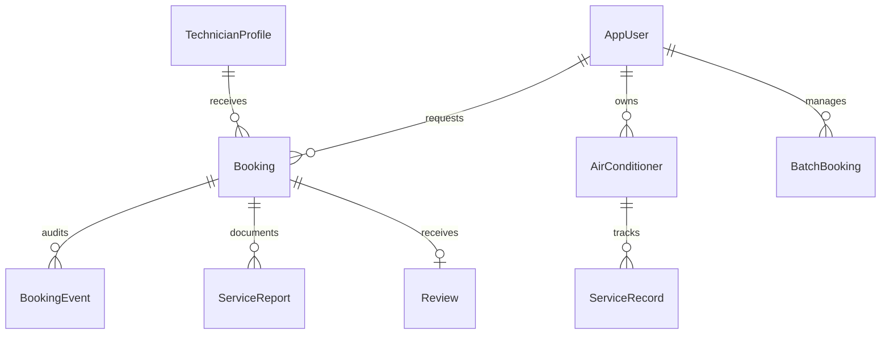

# AirCare Connect — V.1

**A minimal-premium service platform for air-conditioner cleaning.**  
Built for a Software Development portfolio: customer booking, technician discovery, building batch jobs, and an Aircon Passport for per-unit maintenance history.

  

## Product focus

- **Find a technician:** filter by service area, skills, price, and reviews. The match score is rule-based and includes an explanation; it is not represented as machine learning.
- **Booking workflow:** create a service request, accept the appointment, and track Pending → Confirmed → In progress → Completed / Cancelled.
- **Aircon Passport:** keep a maintenance timeline, technician, work summary, price, and next service date for each indoor unit.
- **Batch booking:** create one request for many air-conditioners in a building and track completed units separately from the overall job.
- **Service reports:** checklist and before/after photo URL fields; report completion creates a maintenance record for the related air-conditioner.
- **Role-based demo workspace:** Customer, Technician, Building Manager, and Admin views.

## Tech stack

| Area | Technology |
|---|---|
| Frontend | React 18, TypeScript, Vite, Lucide |
| Backend | ASP.NET Core 8 Web API |
| Persistence | EF Core + SQLite (database is created and demo-seeded on first launch) |
| Authentication | JWT bearer token, role claims, password hashing |
| UI | Responsive custom CSS, Thai-first content, minimal-premium visual system |

## Run locally

### Requirements
- Node.js 20+ and npm
- .NET 8 SDK

### 1. Start the API

Open a terminal at `backend/AirCare.Api`:

```powershell
dotnet restore
dotnet run
```

API base URL: `http://localhost:5080`  
Health check: `http://localhost:5080/health`

The SQLite file `aircare.db` is created in the API project folder on first launch. A fresh database is seeded with sample accounts and records.

### 2. Start the frontend

Open a second terminal at `frontend`:

```powershell
npm install
Copy-Item .env.example .env.local
npm run dev
```

Open `http://localhost:5173`. The frontend supports a local demo-data fallback if the API is not configured or reachable. To use the API, keep `VITE_API_BASE_URL=http://localhost:5080/api` in `.env.local` and start the API first.

## Demo accounts

All sample accounts use the development password `Aircare123!`.

| Role | Email |
|---|---|
| Customer | `customer@aircare.demo` |
| Technician | `technician@aircare.demo` |
| Building manager | `manager@aircare.demo` |
| Admin | `admin@aircare.demo` |

The role switch in the sidebar is a portfolio/demo convenience; the API also checks JWT role claims on protected routes.

## API routes

| Method | Route | Purpose |
|---|---|---|
| POST | `/api/auth/login` | Get JWT |
| POST | `/api/auth/register` | Create a customer account |
| GET | `/api/auth/me` | Current account |
| GET | `/api/dashboard` | Summary metrics |
| GET | `/api/technicians` | Technician search / match |
| GET, POST | `/api/bookings` | List/create bookings |
| GET | `/api/bookings/{id}` | Booking details |
| PATCH | `/api/bookings/{id}/status` | Change booking status with audit event |
| GET | `/api/air-conditioners` | Aircon Passport list |
| GET | `/api/air-conditioners/{id}/passport` | Single unit history |
| GET, POST | `/api/batch-bookings` | Building batch jobs |
| PATCH | `/api/batch-bookings/{id}/progress` | Completed-unit progress |
| GET, POST | `/api/service-reports` | Report list / submission |
| PATCH | `/api/service-reports/{id}/approve` | Customer approval |
| POST | `/api/bookings/{bookingId}/reviews` | Review completed service |

## Project structure

```text
Air-clean-/
├── frontend/
│   └── src/
│       ├── components/    # Sidebar, top bar, booking modal, metric and status components
│       ├── pages/         # Dashboard, technicians, bookings, passport, batch, reports
│       ├── lib/           # API client and demo seed data
│       ├── App.tsx
│       └── index.css
└── backend/AirCare.Api/
    ├── Controllers/       # Auth, booking, technician, passport, batch, report, review APIs
    ├── Data/              # EF Core context and demo seeder
    ├── DTOs/
    ├── Models/
    └── Services/           # DTO conversion and explainable match score
```

## Data model overview



## V.1 scope and honest limitations

- The technician matching score is deterministic rule-based ranking, not ML.
- The UI contains sample data and photo placeholders. A real image storage service is not connected.
- Real payment processing, SMS/email notifications, GPS tracking, production identity verification, and real dispute handling are not implemented.
- The included JWT key and accounts are for local development only. Do not deploy them unchanged.
- Demo mode stores interactions in browser memory; use the API mode for persisted database workflows.

## Portfolio notes

The project demonstrates component-based UI composition, responsive design, REST API design, role-based access, password hashing, JWT authentication, relational data modeling, booking-state transitions, audit history, service reporting, and a transparent rule-based matching algorithm.
