<p align="center">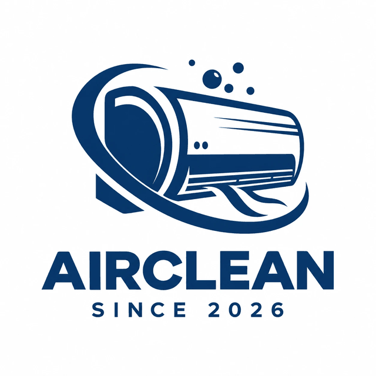</p>

# AirClean

**ภาษาไทย** · [English](README.en.md)

**แพลตฟอร์มจับคู่คนที่อยากล้างแอร์กับช่างแอร์ใกล้บ้าน**
ลูกค้าส่งคำขอครั้งเดียว ช่างในพื้นที่เสนอราคาเข้ามา ลูกค้าเปรียบเทียบแล้วเลือกเอง และช่างจะเห็นที่อยู่จริงก็ต่อเมื่อลูกค้าเลือกช่างคนนั้นแล้วเท่านั้น

[](https://github.com/namethzz/Air-clean-/actions/workflows/build.yml)

ใช้งานจริงที่ **[aircare-connect-web.onrender.com](https://aircare-connect-web.onrender.com)** (เซิร์ฟเวอร์ฟรีจะหลับเมื่อไม่มีคนใช้ เปิดครั้งแรกอาจรอ 30–60 วินาที)

Full stack: React + TypeScript, ASP.NET Core 8, MongoDB · เก็บค่าสมาชิกจริงผ่าน PromptPay และตรวจสลิปกับธนาคารอัตโนมัติ

<table>
  <tr>
    <td>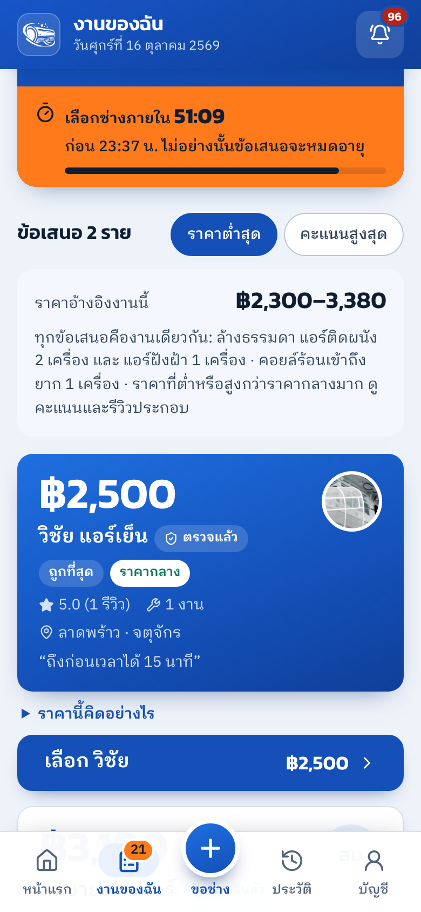</td>
    <td>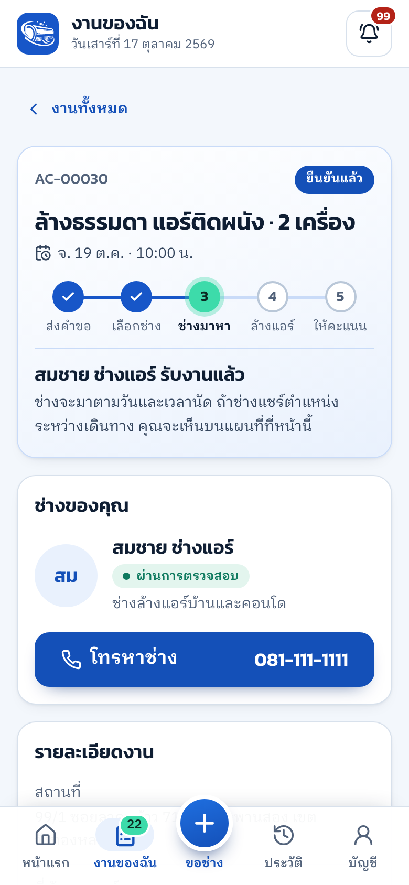</td>
    <td>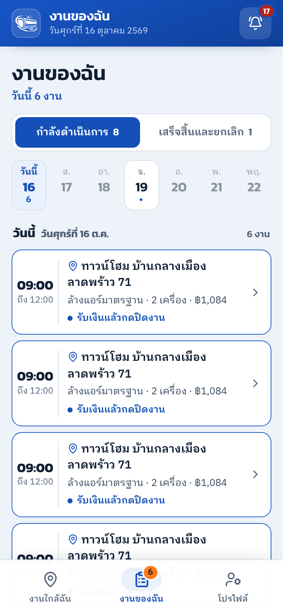</td>
    <td>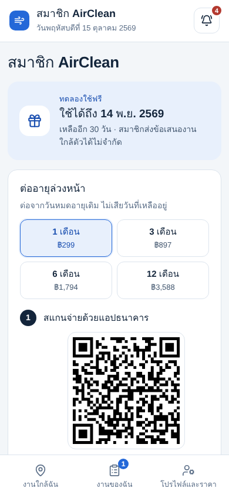</td>
  </tr>
  <tr>
    <td align="center">ลูกค้าเลือกช่างภายใน 1 ชม.</td>
    <td align="center">งานที่ยืนยันแล้ว</td>
    <td align="center">ตารางงานของช่าง</td>
    <td align="center">ต่ออายุสมาชิกด้วย QR</td>
  </tr>
  <tr>
    <td>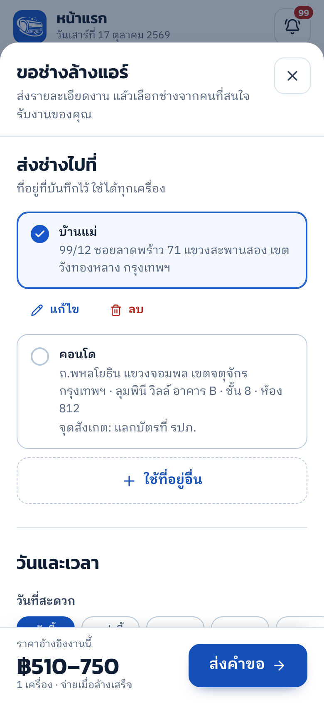</td>
    <td>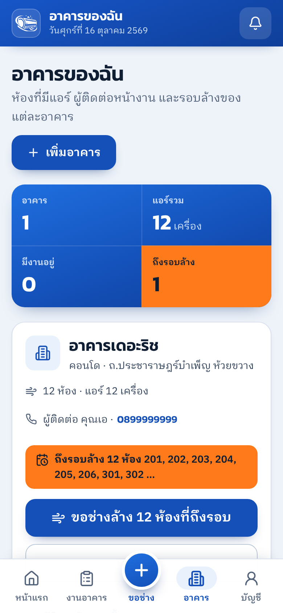</td>
    <td>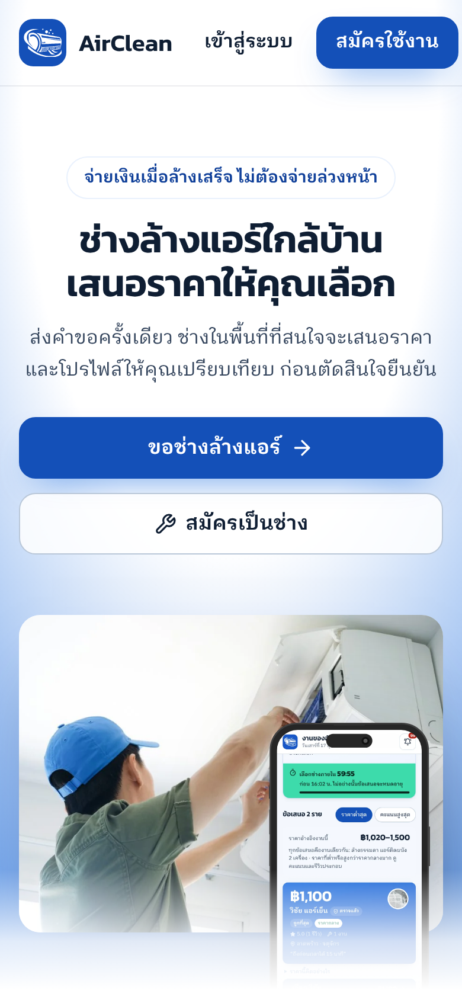</td>
    <td>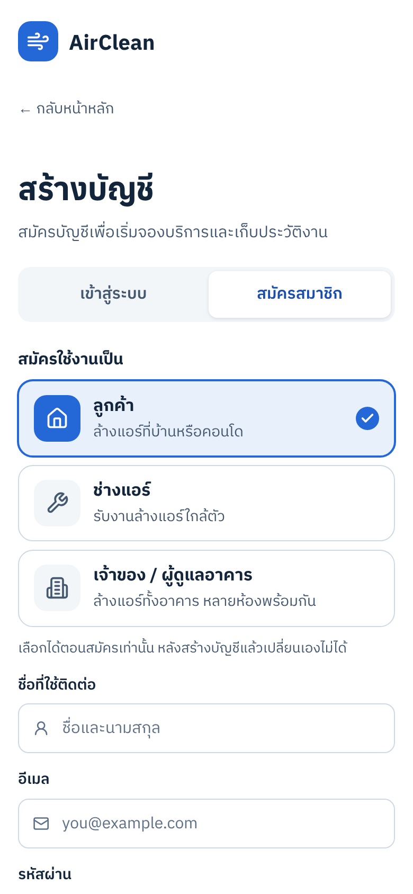</td>
  </tr>
  <tr>
    <td align="center">ฟอร์มขอช่าง</td>
    <td align="center">อาคารแบบรายห้อง</td>
    <td align="center">หน้าแรก</td>
    <td align="center">สมัครตามบทบาท</td>
  </tr>
</table>

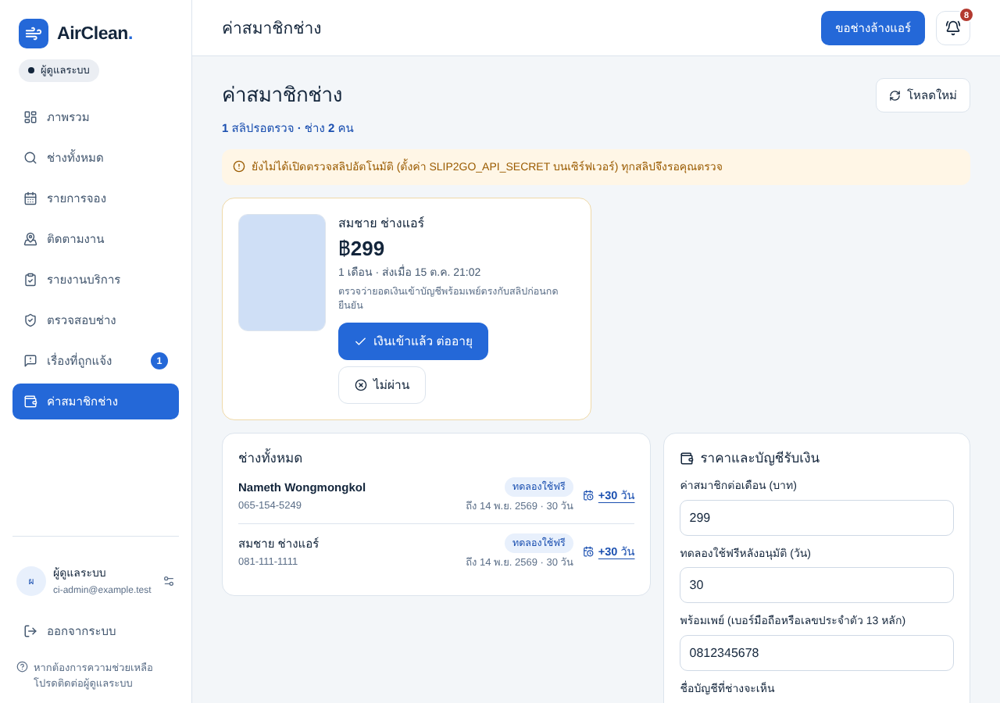

ภาพจากหน้าจอจริงที่ความกว้างมือถือ (390 px) และเดสก์ท็อป ด้วยข้อมูลทดสอบ

## ทำอะไรได้บ้าง

- **ผู้ใช้ 4 บทบาท** ลูกค้า ช่างแอร์ ผู้ดูแลอาคาร (จัดการทั้งตึกแบบรายห้อง) และแอดมิน แต่ละบทบาทมีหน้าของตัวเอง
- **ช่างเสนอราคาแทนราคาตายตัว** ช่างเห็นงานใกล้ตัวเรียงตามระยะทางแล้วเสนอราคา ลูกค้ามีเวลาเลือก 1 ชั่วโมงนับจากข้อเสนอแรก ถ้าหมดเวลา ข้อเสนอหมดอายุและเปิดรับใหม่ได้ในปุ่มเดียว
- **ติดตามงานจริง** หลังยืนยันแล้ว ลูกค้าเห็นตำแหน่งช่างบนแผนที่ โทรหากันได้ เลื่อนวันนัดได้ ช่างติ๊กห้องที่ล้างเสร็จ แนบรูปก่อนและหลังล้าง แล้วปิดงานในขั้นตอนเดียว
- **ตารางงานของช่าง** แยกตามวันพร้อมแถบ 7 วัน และเตือนเมื่อเวลานัดชนกัน
- **เก็บเงินปลายทาง** ลูกค้าจ่ายช่างโดยตรง แพลตฟอร์มไม่ถือเงิน ทั้งสองฝ่ายยืนยัน และถ้ามีข้อโต้แย้งจะเข้าคิวให้แอดมินตัดสิน มีใบเสร็จพร้อมจำนวนเงินเป็นตัวอักษร
- **รับช่างเข้าระบบ** ช่างส่งรูปบัตรประชาชนให้แอดมินตรวจก่อนอนุมัติ หลังอนุมัติใช้ฟรีช่วงทดลอง จากนั้นจ่ายค่าสมาชิกรายเดือนด้วย QR พร้อมเพย์ ระบบตรวจสลิปกับธนาคารผ่าน Slip2Go และต่ออายุให้ทันทีโดยไม่ต้องรอแอดมิน
- **แจ้งเตือน** กระดิ่งในแอปและ Web Push รวมถึง iPhone เมื่อเพิ่มแอปไว้ที่หน้าจอหลัก มีเตือนล่วงหน้าวันนัด ครบรอบล้าง 6 เดือน และสมาชิกใกล้หมดอายุ
- **เข้าสู่ระบบ** อีเมลและรหัสผ่าน หรือ Google (ดึงรูปโปรไฟล์จาก Google ให้ด้วย) ลิงก์ตั้งรหัสผ่านใหม่ใช้ได้ครั้งเดียวและออกจากระบบเครื่องอื่นทั้งหมด

รายการฟีเจอร์ทั้งหมดและการตั้งค่าทุกตัวอยู่ใน [docs/REFERENCE.md](docs/REFERENCE.md) และคำอธิบายผลิตภัณฑ์แบบละเอียดอยู่ใน [docs/PROJECT-SUMMARY.md](docs/PROJECT-SUMMARY.md)

## สถาปัตยกรรม

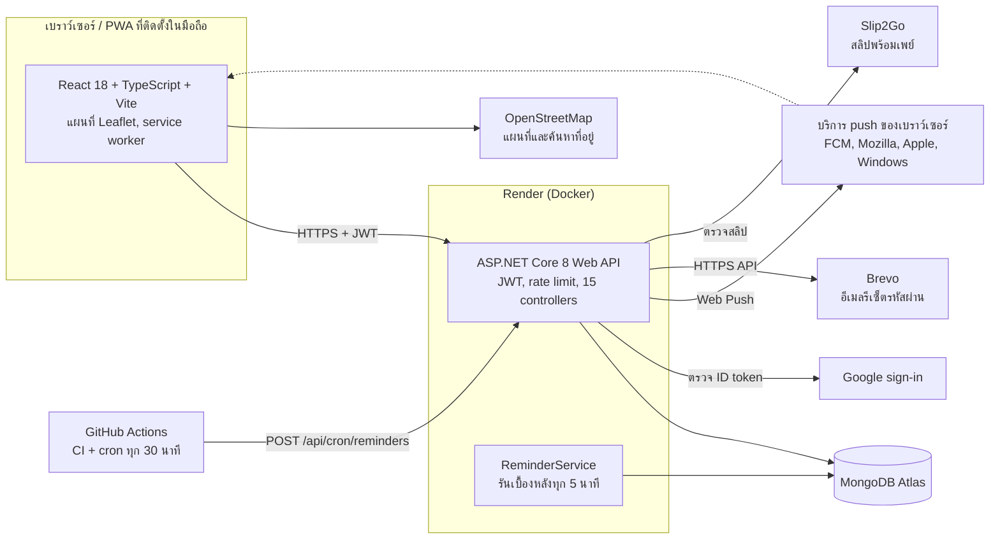

### เส้นทางของงานหนึ่งงาน

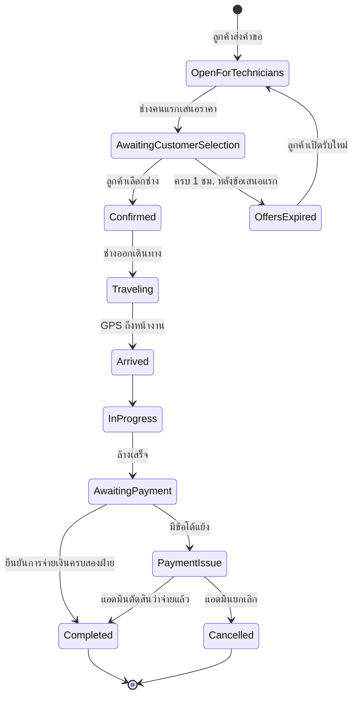

## ปัญหาที่น่าสนใจและเหตุผลที่เลือกวิธีนี้

### 1. ให้ช่างเห็นงานใกล้ตัวโดยไม่เผยว่าลูกค้าอยู่ที่ไหน

หน้างานใกล้ฉันต้องแสดงระยะทาง แต่ถ้าวัดจากหมุดจริง ช่างลองค้นจากหลายจุดก็คำนวณย้อนหาบ้านลูกค้าได้ ระบบจึงวัดระยะจากจุดที่ห่างจากหมุด 300–600 เมตร (`BlurredDistanceKm`) และปัดเป็นกิโลเมตรเต็ม จุดนี้คำนวณจากรหัสงาน ไม่ใช่ค่าสุ่ม การค้นซ้ำหลายครั้งจึงเฉลี่ยหาจุดจริงไม่ได้ ส่วน `OpenJobView` ตัดชื่อ ที่อยู่ พิกัด เบอร์โทร รายการห้อง และราคาของช่างคนอื่นออกจากข้อมูลที่ส่งให้ช่าง ข้อมูลเต็มจะเปิดให้หลังลูกค้ายืนยันช่างคนนั้นแล้วเท่านั้น
ดู `ApiHelpers.cs` และ `BookingOffersController.cs` มีทั้ง unit test และ smoke test ตรวจเรื่องนี้

### 2. สองคนแก้งานเดียวกันพร้อมกัน โดยไม่ใช้ transaction

ระบบไม่ใช้ multi-document transaction แต่ใช้การอัปเดตทีละเอกสารแบบ atomic และ unique index แต่ละกรณีชนกันจึงมีคำตอบชัดเจน

- **สถานะงาน** การเปลี่ยนสถานะ การเสนอราคา และการยืนยันช่าง จะเขียนได้ก็ต่อเมื่อ `UpdatedAt` ยังเป็นค่าที่อ่านมา คำขอที่ช้ากว่าจะได้ `409` ให้โหลดใหม่ แทนที่จะเขียนทับอีกฝ่าย
- **ลิงก์รีเซ็ตรหัสผ่าน** เงื่อนไขอัปเดตรวม hash ของ token ไว้ด้วย ลิงก์จึงใช้ได้ครั้งเดียวแม้มีสองคำขอมาพร้อมกัน
- **ใบเสร็จ** ต้องเป็น `ReceiptNo == null` เท่านั้น กดสองครั้งก็ได้เลขเดียว
- **ค่าสมาชิก** partial unique index ให้หนึ่งรายการโอนต่ออายุได้ครั้งเดียว และช่างหนึ่งคนมีสลิปรอตรวจได้ใบเดียว การต่ออายุเป็น update เดียวด้วย `$max` + `$dateAdd` ทำให้การอนุมัติกับการแจกวันฟรีที่เกิดพร้อมกันนับครบทั้งคู่

### 3. Web Push โดยไม่ใช้ไลบรารี

เขียนตามมาตรฐานโดยตรง RFC 8030 (ส่งข้อความ), RFC 8291 (เข้ารหัส `aes128gcm`) และ RFC 8292 (VAPID) ด้วย cryptography ที่มากับ .NET เท่านั้น (`WebPushSender.cs`) คู่กุญแจสร้างครั้งเดียวแล้วเก็บในฐานข้อมูล deploy ใหม่จึงไม่ต้องตั้งค่าอะไร และในโหมด production รับ endpoint เฉพาะโดเมนของบริการ push ที่รู้จัก กันไม่ให้ URL ที่ผู้ใช้ส่งมาสั่งให้เซิร์ฟเวอร์ยิงไปที่อื่น
การตรวจการเข้ารหัสด้วยโค้ดของตัวเองพิสูจน์อะไรได้ไม่มาก `tests/fake_push.py` จึงทำตัวเป็นเบราว์เซอร์และบริการ push ที่ตรวจลายเซ็น VAPID และถอดรหัสข้อความแยกจากโค้ดหลัก

### 4. กฎที่ขึ้นกับเวลา บนเซิร์ฟเวอร์ที่หลับได้

ข้อเสนอต้องหมดอายุหลัง 1 ชั่วโมง และการแจ้งเตือนต้องออกตรงเวลา แต่เซิร์ฟเวอร์ฟรีหลับเมื่อไม่มีคนใช้ ระบบจึงไม่พึ่งตัวตั้งเวลาตัวเดียว

- การหมดอายุถูกตรวจทุกครั้งที่มีการอ่านข้อมูลงาน (`OfferTimer.ExpireDueAsync`)
- `ReminderService` รันทุก 5 นาทีระหว่างที่เซิร์ฟเวอร์ตื่น
- GitHub Actions เรียก `POST /api/cron/reminders` ทุก 30 นาทีช่วง 07:00–21:00 ซึ่งปลุกเซิร์ฟเวอร์ไปด้วย endpoint นี้เทียบ key แบบ constant time และไม่มีอยู่เลยถ้าไม่ได้ตั้ง `CRON_KEY`

การแจ้งเตือนทุกรายการ "จอง" ในฐานข้อมูลด้วย conditional update ก่อนส่ง รันซ้อนกันก็ส่งแค่ครั้งเดียว

### 5. ตรวจสลิปค่าสมาชิกให้แน่ใจว่าเงินเข้าจริง

ช่างโอนผ่าน QR พร้อมเพย์ที่ระบบสร้างเองตามมาตรฐาน EMVCo (ตรวจกับไลบรารี `promptpay-qr` แล้วได้ผลตรงกัน) แล้วแนบสลิป เซิร์ฟเวอร์ส่งรูปไปที่ Slip2Go พร้อมเงื่อนไขครบชุด ได้แก่ ต้องเป็นรายการโอนจริง, เข้าพร้อมเพย์ของ AirClean, ยอดตรงทุกสตางค์, โอนไม่เกิน 2 วัน และไม่เคยใช้มาก่อน
ผลแยกเป็น 3 แบบ: ผ่าน (ต่ออายุทันที), ไม่ผ่าน (บอกเหตุผล เช่น สลิปซ้ำ หรือโอนผิดบัญชี) และยังตัดสินไม่ได้ (ธนาคารยังไม่ยืนยัน หรือบริการล่ม) แบบสุดท้ายระบบตรวจซ้ำเองทุกไม่กี่นาที และแจ้งแอดมินเฉพาะเมื่อจำเป็น นอกจากนี้ยังเก็บ hash ของรูปและเลขรายการไว้กันสลิปซ้ำแม้แอดมินจะเป็นคนอนุมัติเอง

## เทคโนโลยี

| ส่วน | เทคโนโลยี |
|---|---|
| Frontend | React 18, TypeScript, Vite, Leaflet + OpenStreetMap, PWA ที่ติดตั้งได้พร้อม service worker |
| Backend | ASP.NET Core 8 Web API, JWT, ASP.NET Identity password hashing, rate limit แบบ sliding window ต่อผู้ใช้ |
| Database | MongoDB (Atlas ใน production) กับ .NET driver ทางการ |
| บริการภายนอก | Google sign-in, Brevo (อีเมล), Web Push (VAPID), Slip2Go (ตรวจสลิป) |
| Deploy | Render: Docker สำหรับ API (กำหนดใน `render.yaml`) และ static site สำหรับ frontend |
| CI | GitHub Actions: build ทั้งสองฝั่ง, unit test (xUnit + Vitest) และ smoke test กับ MongoDB ชั่วคราว |

## โครงสร้างโปรเจกต์

```
backend/AirClean.Api
  Controllers/   หนึ่ง controller ต่อหนึ่งเรื่อง ทั้งหมดอยู่ใต้ /api:
                 Auth, Notifications, Addresses, Technicians, Bookings, BookingOffers,
                 JobCompletion, Issues, Receipts, JobPhotos, Dashboard, AirConditioners,
                 ServiceReports, Reviews, Membership
                 AirCleanControllerBase เก็บสิ่งที่ใช้ร่วมกัน (ฐานข้อมูล ผู้ใช้ที่ล็อกอิน การแจ้งเตือนสถานะ)
                 ApiHelpers เก็บกฎที่เป็น pure function (ราคา ระยะทาง ช่วงเวลา)
  Services/      Notifier, WebPushSender, EmailSender, SlipVerifier, ExternalIdentityValidator,
                 OfferTimer, ReminderService, Membership
  Models/ DTOs/ Data/   entity, สัญญา request/response, MongoStore และ index
backend/AirClean.Api.Tests   unit test (xUnit)
frontend/src
  pages/         หนึ่งไฟล์ต่อหนึ่งหน้าจอ เลือกหน้าด้วย page key ใน App.tsx
  components/    ส่วนที่ใช้ร่วมกัน: ฟอร์มขอช่าง แผนที่ ตัวเลือกเวลา กระดิ่งแจ้งเตือน
  lib/           API client, QR พร้อมเพย์, จำนวนเงินเป็นตัวอักษร, ตรวจเวลานัดชน (+ unit test)
tests/           smoke test แบบ end-to-end และตัวจำลอง Google, push, Brevo, Slip2Go
docs/            REFERENCE.md (การตั้งค่า), PROJECT-SUMMARY.md, screenshots/
```

## รันบนเครื่องตัวเอง

ต้องมี .NET 8 SDK, Node 20 และ MongoDB (ใช้ container สะดวกที่สุด)

```bash
# 1. ฐานข้อมูล
docker run -d --name airclean-mongo -p 27017:27017 mongo:7

# 2. API ที่ http://localhost:5080 พร้อมข้อมูลตัวอย่าง
cd backend/AirClean.Api
MONGODB_URI=mongodb://localhost:27017 MONGODB_DATABASE=airclean_demo \
JWT_KEY="any-random-string-of-at-least-32-characters" \
SEED_DEMO_DATA=true dotnet run

# 3. Frontend ที่ http://localhost:5173 (อีกหน้าต่าง)
cd frontend
cp .env.example .env.local
npm install
npm run dev
```

บัญชีตัวอย่างมีเฉพาะในฐานข้อมูลที่ seed แบบนี้ รหัสผ่านทุกบัญชีคือ `Aircare123!`

| บทบาท | อีเมล |
|---|---|
| ลูกค้า | `customer@aircare.demo` |
| ช่าง | `technician@aircare.demo` (และ `technician2@…`, `technician3@…`) |
| ผู้ดูแลอาคาร | `manager@aircare.demo` |
| แอดมิน | `admin@aircare.demo` |

การ seed ทำเฉพาะเมื่อฐานข้อมูลยังไม่มีผู้ใช้ และไม่ทำเลยเมื่อ `ASPNETCORE_ENVIRONMENT` เป็น `Production`

## การทดสอบ

รันทุก pull request ใน CI มี 3 ชั้น

| ชั้น | อยู่ที่ | ทดสอบอะไร | คำสั่ง |
|---|---|---|---|
| Unit (backend) | `backend/AirClean.Api.Tests` | ตรวจสลิปกับ Slip2Go จำลอง (ทุกรหัสผลลัพธ์), ช่วงเวลานัด, ระยะทางแบบเบลอ, สถานะสมาชิก, ราคา, ชื่อย่อ | `dotnet test backend/AirClean.Api.Tests` |
| Unit (frontend) | `frontend/src/lib/*.test.ts` | QR พร้อมเพย์, เวลานัดชน, รายการห้อง, เวลานับถอยหลัง, จำนวนเงินเป็นตัวอักษร | `npm test` ใน `frontend/` |
| End-to-end | `tests/marketplace_smoke.py` | เรียก API จริงกับฐานข้อมูลชั่วคราว: สิทธิ์ข้อมูล, ความเป็นส่วนตัวของที่อยู่, การอนุมัติช่าง, การเขียนพร้อมกัน, รีเซ็ตรหัสผ่าน, Google sign-in, push, ข้อโต้แย้งการจ่ายเงิน, ใบเสร็จ, ค่าสมาชิก, เวลาแจ้งเตือน | `python3 tests/marketplace_smoke.py` |

smoke test ต้องรันกับฐานข้อมูลที่ทิ้งได้เท่านั้น (ดูค่าที่ใช้ใน `.github/workflows/build.yml`) ห้ามชี้ไปที่ฐานข้อมูลจริง

## วิธีพัฒนา

โปรเจกต์นี้พัฒนาร่วมกับ AI coding assistant (Claude Code) ผู้พัฒนาเป็นคนกำหนดโจทย์และตัดสินใจเรื่องผลิตภัณฑ์ทั้งหมด เช่น บทบาทผู้ใช้ ให้ลูกค้าโทรคุยกับช่างแทนการขอเลื่อนนัดในระบบ เวลาเลือกช่าง 1 ชั่วโมง โมเดลค่าสมาชิกรายเดือน และการเลือก Slip2Go รวมถึงทดสอบกับผู้ใช้และเงินจริง ดูแล deploy และระบบที่รันอยู่ ทุกการเปลี่ยนแปลงผ่าน pull request ที่อธิบายเหตุผลไว้ และต้องผ่าน CI ก่อน merge

## ข้อจำกัดที่ยังมี

- รูปงาน รูปเอกสาร และสลิปเก็บใน MongoDB ถ้าใช้งานมากควรย้ายไป object storage
- ยังไม่มีการยืนยันอีเมลตอนสมัคร
- เซิร์ฟเวอร์ฟรีหลับเมื่อไม่มีคนใช้ ครั้งแรกจึงช้า

รายการเต็มอยู่ใน [docs/REFERENCE.md](docs/REFERENCE.md#limitations-before-a-public-launch)

> ชื่อแรกของโปรเจกต์คือ "AirCare Connect" ชื่อบริการบน Render (`aircare-connect-api`, `aircare-connect-web`), ชื่อฐานข้อมูล, issuer ของ JWT และ key ใน localStorage ยังใช้ชื่อเดิม เพราะถ้าเปลี่ยนจะทำให้ URL ที่ใช้งานอยู่เปลี่ยน หรือทำให้ผู้ใช้ทุกคนหลุดจากระบบ
